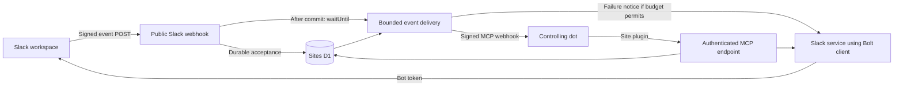

# SlackDot specification

Status: Sites-only bounded delivery and best-effort failure feedback implemented and verified in the compatibility prototype. The feasibility decision and transition checkpoint are recorded; full-product implementation remains. External schedulers/services are disallowed.
Last updated: 2026-11-02  
Companion document: [Compatibility prototype plan](compatibility-prototype-plan.md)
Next phase: [Full application implementation plan](implementation-plan.md)

## 1. Purpose

SlackDot is a TypeScript Slack app that exposes an MCP server so an OpenAI dot can communicate in a Slack workspace through a Slack Bot User OAuth token. The dot can read and send messages in the bot's direct messages and in channels the bot has joined. MCP Events notify the dot of matching Slack activity without requiring the dot to poll for messages.

ChatGPT Sites is the intended application deployment platform. The Site will be public so Slack can reach its webhook endpoint without encountering a ChatGPT sign-in gate. Sensitive application operations remain authenticated and authorized.

This document records the full target behavior. It distinguishes that target from capabilities that still require a hosted compatibility test. The hosted compatibility prototype passes the accepted bounded contract; see [prototype results](compatibility-prototype-results.md) for evidence, scope, and remaining production verification.

## 2. Accepted decisions

1. Use TypeScript and Slack's Bolt SDK.
2. Use one Slack workspace installation and one bot token per deployment.
3. Exactly one dot controls that bot at any given time. This is an operating constraint, not a distributed ownership system.
4. Do not implement multi-dot ownership, leases, agent routing, per-agent message attribution, or communication between dots through a shared bot.
5. Multiple filtered event subscriptions from the controlling dot are allowed. They do not imply multiple bot owners.
6. Expand the originally requested OAuth scopes when needed for the agreed features.
7. Deploy the entire application through ChatGPT Sites, using a public Site and server-side authorization for protected routes. External schedulers and separately hosted delivery infrastructure are explicitly disallowed.
8. Prefer MCP 2.0 HTTP, protocol revision `2026-07-28`, and the webhook event profile documented by OpenAI.
9. Use durable storage for subscriptions, accepted Slack events, deduplication, and delivery state.
10. Start without protocol replay: return `cursor: null` and explicitly document that limitation.
11. Validate the platform with a narrow prototype before implementing the full tool catalog.
12. Use automatic post-acceptance delivery with bounded retries in the originating request's `waitUntil()` window. On exhaustion or permanent delivery failure, retain terminal state and attempt one threaded Slack failure notice. Eventual delivery and guaranteed failure notification after interruption are explicitly not promised. This accepted tradeoff replaces the earlier durable delayed-recovery requirement.

## 3. Scope

### Required target functionality

- Discover the bot's accessible public channels, private channels, and existing one-to-one DMs.
- Find workspace users by available profile information and Slack user ID.
- Open a bot-to-user DM.
- Read conversation messages and retrieve thread context where the installed bot token supports it.
- Send channel messages, DM messages, and threaded replies as the bot.
- Update and delete messages authored by the bot.
- Read, add, and remove emoji reactions using the bot identity.
- Subscribe to new messages, with conversation, thread, sender, and mention filters.
- Handle edits, deletions, and reactions as distinct event types.
- Persist subscription state across request termination, restarts, and deployments.
- Retry transient outbound delivery failures within a bounded Sites request background-execution budget, then attempt threaded failure feedback when appropriate.
- Expose useful connection and error information without exposing credentials or private data publicly.

### Non-goals

- Multiple bots, workspace installations, or controlling dots in one deployment.
- Separate Slack identities for different tasks or conversations.
- Group DMs, organization-wide installation management, or Enterprise Grid administration.
- Reading conversations the bot cannot access, or DMs between other users.
- Workspace-wide message search, file upload/download, channel creation, automatic joining, invitations, or membership administration.
- Email-address lookup unless a later feature explicitly requires it.
- A separate language-model runtime or an OpenAI API key: the dot performs reasoning outside SlackDot.
- A rich administration dashboard, Slack Agent View UI, slash commands, or interactive Block Kit workflows in the initial version.
- Supporting every revision or delivery mode of the evolving MCP Events proposal.
- A general webhook delivery product or an exactly-once distributed messaging guarantee.

## 4. User workflows

### Conversation initiated by the dot

1. The dot identifies a permitted channel or a Slack user.
2. For a new DM, it opens the conversation and obtains its conversation ID.
3. It calls a messaging tool with the conversation ID, text, and optional parent thread timestamp.
4. SlackDot authorizes the call and uses the server-held bot token to call Slack.
5. The tool returns the actual Slack conversation ID and message timestamp.

### Conversation initiated in Slack

1. The controlling dot has an active subscription for the relevant conversation or message filter.
2. A person posts a matching message in Slack.
3. Slack sends the event to the public `/slack/events` endpoint.
4. SlackDot verifies the request, durably accepts it, and promptly acknowledges Slack.
5. After persisting the normalized event and matching deliveries, SlackDot automatically starts signed callback delivery in `ctx.waitUntil()`, without waiting for the callback before returning Slack's acknowledgment.
6. The dot decides whether to retrieve more context or respond, according to the user's instructions.
7. If it responds, it calls a SlackDot tool. SlackDot suppresses its own bot's resulting activity from automatic event delivery to prevent a response loop.
8. If callback receipt cannot be confirmed within the delivery budget, SlackDot records the terminal outcome and attempts one failure notice in the source thread. Callback acceptance is sufficient for success; waiting for the dot to finish its task or reply is not part of the delivery budget.

Installing SlackDot alone does not instruct the dot to answer every Slack message. Event subscriptions and the dot's response instructions are established in ChatGPT.

## 5. Slack configuration and permissions

### Bot scopes

The initial requested scope set is the user's original list plus `channels:read` and `groups:read`:

| Scope | Purpose |
| --- | --- |
| `app_mentions:read` | Receive explicit mentions of the bot. |
| `assistant:write` | Retained from the requested scopes; not a dependency of basic messaging. Agent UI features are outside the initial implementation. |
| `channels:read` | Discover public channels and inspect their metadata/membership. |
| `channels:history` | Read messages and receive message events in joined public channels. |
| `chat:write` | Post messages and modify the bot's own messages. |
| `groups:read` | Discover private channels accessible to the bot and inspect their metadata. |
| `groups:history` | Read messages and receive message events in joined private channels. |
| `im:history` | Read and receive events in bot DMs. |
| `im:read` | Discover and inspect bot DMs. |
| `im:write` | Open bot-to-user DMs. |
| `reactions:read` | Read reactions and receive reaction events. |
| `reactions:write` | Add and remove the bot's reactions. |
| `users:read` | List users and retrieve available profile information. |

Do not add `chat:write.public`, `chat:write.customize`, channel-join scopes, `mpim:*`, file scopes, or `users:read.email` without a corresponding approved feature. Posting remains tied to the bot's actual identity and conversation access. Scope changes require reinstallation or reauthorization in Slack as appropriate.

### App configuration

- Enable the bot and the Messages tab, including user message input.
- Enable the HTTP Events API and use the deployed public `/slack/events` URL.
- Complete Slack's URL-verification challenge.
- Subscribe to `message.channels`, `message.groups`, `message.im`, and `app_mention`.
- Subscribe to `reaction_added` and `reaction_removed` for the full implementation.
- Handle installation revocation/uninstallation signals where available, and disable affected operations when Slack reports invalid or revoked credentials.
- Use HTTPS event delivery. Socket Mode is outside the Sites implementation target.
- Install the app and explicitly add the bot to channels it should use.

The published Slack app manifest must be checked against the actual granted token scopes. Application startup/setup should use `auth.test` to establish the configured workspace and bot identity. Do not infer those values from user-controlled tool arguments.

## 6. Deployment architecture

### Sites application

- Preserve the supported Sites build integration and deployment manifest.
- Use the supported server starter with a Cloudflare Workers request entry point.
- Declare the `mcp` capability and a D1 binding in `.openai/hosting.json`.
- No R2 binding is needed for the initial scope.
- Expose stateless MCP HTTP requests at `/mcp`; subscription state lives in D1, not in an MCP session or Worker isolate.
- Use the Site-created plugin and Sites' MCP identity mechanism when supported by the hosted compatibility tests.
- Store runtime credentials through Sites secrets/environment settings. Never put secrets into source, deployment manifests, browser code, or tool results.

### Bolt integration

Use a small Fetch-compatible custom Bolt receiver to bridge the Workers request lifecycle into Bolt. Preserve raw request bytes for Slack signature verification. Keep the receiver responsible for request verification, challenge handling, durable acceptance, and acknowledgment timing. Keep application listeners short and attach delivery explicitly to the request execution context after persistence succeeds.

The prototype must prove the selected Bolt and Slack Web API client versions actually bundle and run in Sites. Node compatibility support does not by itself prove the complete dependency graph works. Avoid relying on an always-running `app.start()` process, in-memory job queue, or resident Socket Mode connection.

### Bounded Sites-only execution

The accepted design uses the Sites Worker's `ctx.waitUntil()` to deliver after durable acceptance while returning Slack's acknowledgment promptly. It invokes the delivery module directly, without a self-HTTP call, manual trigger, polling schedule, external scheduler, or separately hosted service.

Use a conservative budget measured from the start of post-commit background work: up to 20 seconds for delivery, the next five seconds reserved for terminal-state persistence and failure feedback, and a safety margin before the platform's 30-second post-response limit. These are aggregate request budgets, including database work, authorization checks, callback calls, retry delays, and multiple matching subscriptions. They are not fresh budgets for each attempt or subscription. Apply actual cancellation/timeouts to network operations; a loop condition or Promise.race alone does not stop an in-flight request.

Allow at most three total attempts per event/subscription, including the initial attempt, with short exponential backoff (initial target: one second, then two seconds). Start fewer attempts when the deadline or Retry-After requires it. Exact per-call caps must fit the aggregate budget and be validated in the prototype; the existing ten-second callback and eight-second Slack call timeouts cannot simply be reused for every operation. All background tasks from the same request share the platform window.

This is best-effort execution with durable records, not a durable execution service. Runtime termination, deployment interruption, or a crash between commit and scheduling can leave unresolved state and prevent both delivery and its failure notice. The user explicitly accepts this limitation for Sites-only deployment. Retain that state for inspection; do not claim autonomous later recovery, eventual delivery, or guaranteed notification. A surviving record is evidence of persistence, not evidence that it will run again.

### Suggested module boundaries

| Module | Responsibility |
| --- | --- |
| `slack/receiver` | Verify and acknowledge Slack HTTP requests; bridge into Bolt. |
| `slack/service` | Typed Slack operations and token-bound workspace checks. |
| `slack/normalize` | Normalize message, mention, edit, delete, and reaction payloads. |
| `mcp/server` | Core discovery, tool discovery, tool calls, and request authorization. |
| `mcp/events` | OpenAI-compatible event methods, schemas, and protocol errors. |
| `events/subscriptions` | Subscription identity, validation, expiration, and refresh. |
| `events/delivery` | Matching, signed callback verification, delivery, and retries. |
| `storage` | D1 schema and durable state operations. |
| `runtime` | Sites bindings, secrets, request context, and bounded background execution. |

These are code boundaries, not requirements for separate services or a generalized plugin framework.

## 7. Public hosting and authorization

Public Site access removes the platform sign-in gate for Slack's webhook. It does not authorize anonymous callers to send messages or access Slack data.

| Surface | Access policy |
| --- | --- |
| `/` and `/health` | Public, non-sensitive service information only. |
| `/slack/events` | Publicly reachable; requires valid Slack signatures and freshness checks. |
| `/mcp` tool calls and event subscription operations | Require a trusted Sites-authenticated principal matching the configured owner. |
| MCP discovery/catalog metadata | Protected by default; may be exposed without Slack data only if the native plugin scanner requires it and that behavior is explicitly verified. |
| Retained manual diagnostic delivery endpoint, if any | Requires service authentication; rejects anonymous requests and cannot reset expired delivery budgets or revive terminal jobs. It is not required for normal delivery. |
| Any diagnostics or configuration interface | Owner-authorized; never a public view of messages, subscribers, or secrets. |

Requirements:

- Configure the owner from trusted setup or authenticated owner context. Never grant ownership to the first unauthenticated request.
- Validate the trusted Sites identity headers and demonstrate that external clients cannot forge them through the public ingress.
- A signed-in visitor who is not the configured owner cannot invoke protected operations merely because the Site is public.
- Use one owner authorization boundary. Do not create per-agent ownership, roles, or routing.
- Preserve authentication on `events/subscribe` and `events/unsubscribe`; callback verification alone does not authorize a subscription.
- Authorize conversation access when creating subscriptions and throughout their lifetime. Stop delivery when the bot loses access or the installation is revoked.
- Keep the Slack bot token entirely server-side. An MCP client never supplies or receives it.

Changing the controlling dot is an operational handoff: stop the old dot's monitoring and remove obsolete subscriptions before connecting the replacement. No automated ownership-transfer protocol is required.

## 8. MCP tool contract

Tool names below are the proposed stable public names. Inputs use Slack IDs, not ambiguous display names. All tools operate within the single configured workspace.

| Tool | Essential arguments | Behavior |
| --- | --- | --- |
| `slack_get_connection_info` | None | Return non-secret workspace/bot identity and enabled capabilities. |
| `slack_list_conversations` | Optional conversation types, `cursor`, `limit` | Return accessible joined channels and bot DMs. Filter public channel discovery by bot membership. |
| `slack_get_conversation` | `conversation_id` | Return permitted conversation metadata and availability. |
| `slack_list_users` | Optional `cursor`, `limit`, name filter | Return available user profiles; no email lookup. A filter may be implemented over paginated/cached profile data, not an invented Slack search method. |
| `slack_get_user` | `user_id` | Return available profile information for the specified Slack user. |
| `slack_open_dm` | `user_id` | Open or retrieve the bot's one-to-one DM and return its conversation ID. |
| `slack_get_messages` | `conversation_id`, optional time bounds, `cursor`, `limit` | Read paginated conversation history. |
| `slack_get_thread` | `conversation_id`, `thread_ts`, optional `cursor`, `limit` | Retrieve thread context; report source/completeness and any unsupported token behavior. |
| `slack_send_message` | `conversation_id`, `text`, `request_id`, optional `thread_ts` | Post a new message or thread reply and return Slack identifiers. |
| `slack_update_message` | `conversation_id`, `message_ts`, `text`, `request_id` | Update a bot-authored message. |
| `slack_delete_message` | `conversation_id`, `message_ts`, `request_id` | Delete a bot-authored message. |
| `slack_get_reactions` | `conversation_id`, `message_ts` | Return reaction information available from Slack. |
| `slack_add_reaction` | `conversation_id`, `message_ts`, `emoji_name`, `request_id` | Add the bot's reaction. |
| `slack_remove_reaction` | Same as add | Remove the bot's reaction. |

### Common behavior

- Validate input and output schemas. Use the MCP SDK for core protocol behavior and isolate the event-extension adapter.
- Return structured data with a concise text representation suitable for the agent.
- Keep `ts` and `thread_ts` as strings. Never parse Slack message identifiers into floating-point values.
- Bound pagination and response sizes. Return continuation cursors rather than fetching an entire workspace implicitly.
- Return Slack IDs and normalized error categories; do not leak credentials, raw headers, or callback URLs/secrets.
- Distinguish not-found, not-in-conversation, missing-scope, rate-limited, unavailable, and ambiguous-write outcomes.
- Respect Slack rate limits and `Retry-After`; do not hold MCP requests open indefinitely while sleeping through long limits.
- Mark read tools and write/destructive tools accurately in MCP metadata. Tool annotations are not a substitute for authorization.
- Initially support plain text and Slack `mrkdwn`; raw arbitrary Block Kit and file payloads are outside scope.
- Keep replies in their specified thread. Do not broadcast replies to a channel by default.

### Write idempotency

Use an application `request_id` and a hash of the requested operation to detect repeated calls. Return a stored successful result for the same request and arguments. Reject reuse of a request ID for a different operation. Track in-flight and ambiguous outcomes as well as successes.

There is no transaction spanning D1 and Slack. If Slack may have accepted a write but its response was lost, do not blindly create another message. Reconcile using available Slack identifiers/history where possible, or report that the outcome is uncertain. The interface must not claim exactly-once Slack writes.

## 9. MCP Events contract

### Compatibility profile

Implement the OpenAI-documented webhook profile for dots, using the same authenticated `/mcp` endpoint as tools:

- Advertise `events` alongside `tools` in the supported discovery response.
- Implement `events/list`, `events/subscribe`, and `events/unsubscribe` as protocol methods, not ordinary MCP tools.
- Advertise only `webhook` delivery.
- Use `inputSchema` for subscription arguments and `payloadSchema` for delivered event data.
- Use the MCP SDK's selected protocol envelopes and validate actual wire responses against the client. Do not mix incompatible examples from different protocol revisions.
- Do not implement polling, event streaming, `gap`, or `terminated` notifications for the initial OpenAI integration.
- Follow OpenAI's documented behavior where the evolving SEP differs. Pin dependency versions and preserve tested protocol fixtures.

OpenAI's documentation currently identifies callback verification failure as `-32015` (`CallbackEndpointError`); newer draft material has changed error numbering. Treat this as a compatibility fixture rather than silently tracking the latest draft.

### Event catalog

| Event | Meaning |
| --- | --- |
| `slack.message.created` | A newly posted user message or eligible message from another bot. |
| `slack.message.updated` | An existing message was edited. |
| `slack.message.deleted` | An existing message was deleted. |
| `slack.reaction.added` | A reaction was added to a message. |
| `slack.reaction.removed` | A reaction was removed from a message. |

Do not expose a separate mention event initially. Represent an explicit bot mention as a property of the normalized message and support it as a subscription filter.

### Subscription filters

Require `conversation_id` for each initial event subscription. This permits monitoring any supported conversation while keeping the first implementation's subscriptions narrow and explicit.

- `thread_ts`: optional; match the selected root/thread, with documented inclusion of the root message.
- `sender_user_ids`: optional for message events; match message authors. For deletions whose author cannot be resolved, do not infer a match.
- `mentions_only`: optional for created/updated message events; match explicit mentions of the configured bot.
- `include_bot_messages`: default `false`; when enabled, includes other bots only. The app's own bot remains excluded.
- `actor_user_ids` and `emoji_name`: optional for reaction events.

Each event exposes only filters that it can implement correctly. Reject unknown fields and invalid combinations. For unavailable edit/delete metadata, retain unknown values explicitly rather than fabricating an author, thread, or message text.

### Event payloads

All delivered events use the envelope fields `eventId`, `name`, `timestamp`, `data`, and `cursor`. `timestamp` is the occurrence time in ISO 8601 form. `cursor` is `null` initially.

Common application data includes:

- `workspace_id`, `conversation_id`, and `message_ts`.
- `thread_ts` when known.
- Author or actor IDs when available.
- Text or a bounded preview when applicable, with an explicit truncation indicator.
- Bot/mention flags when applicable.
- Event-specific edit, deletion, or reaction details.

Use a unique stable event ID across retries. Message text remains untrusted data; it must not be converted into instructions about how the dot should behave. Minimize event payloads and use the read tools for additional context.

### Subscription lifecycle

1. Authorize the owner, event, and conversation; validate arguments.
2. Validate the HTTPS callback and client-supplied `whsec_` secret, including decoded key length required by the OpenAI profile.
3. Send and verify a signed, short-lived callback challenge before releasing Slack data.
4. Persist the subscription with a deterministic identity derived from principal, callback URL, event name, and canonical JSON arguments.
5. Return the granted expiration as `refreshBefore`, with `cursor: null` and `truncated: false` for the non-replay profile.
6. Treat a repeated matching subscribe request as a refresh/upsert, including the supported secret-rotation behavior.
7. Stop deliveries at expiration, on unsubscribe, on revoked access, or when the installation is disabled.
8. Make unsubscribe idempotent and match the authenticated subscription identity; knowledge of a subscription ID grants no authority.

Use a finite subscription lifetime with a 72-hour default. The current implementation also caps grants at 72 hours and honors shorter requested lifetimes; future configurability must preserve this default. Honor requested lifetime limits according to the documented profile. The initial server may decline a no-expiration request by granting a finite lifetime. Expiration must be enforced during delivery even if a cleanup job has not run.

### Callback security and signatures

- Require HTTPS and block redirect following during both verification and delivery.
- Prevent requests to local/private/non-public destinations. Validate the chosen approach in the Workers runtime rather than assuming Node-specific DNS pinning is available.
- If the implementation restricts callbacks to trusted OpenAI origins, establish the allowlist from verified integration information; do not guess domains or use loose suffix matching. Arbitrary callback destinations are not a product requirement.
- Use Standard Webhooks signatures and send `webhook-id`, `webhook-timestamp`, `webhook-signature`, and `X-MCP-Subscription-Id`.
- Follow the OpenAI profile's requirement that the delivery `webhook-id` match the envelope `eventId`.
- Serialize each body once and sign/send the same bytes. Generate a fresh signing timestamp and signature for each retry.
- Send one event per request, no larger than 256 KiB. Prefer substantially smaller payloads.
- A `2xx` acknowledges receipt, not completion of the dot's work.
- Retry transient failures with bounded backoff within the shared execution budget. Honor Retry-After; if the requested wait does not fit, stop attempts rather than retry early. Do not retry a delivery rejected with `410` or `413`; do not interpret an individual `410` as authority to remove unrelated subscriptions.

## 10. Event processing and durability

### Ingress

- Validate Slack's signature over the raw body, its timestamp, and the expected installation/app context.
- Support Slack's challenge response without initiating message processing.
- Durably record an accepted event before returning success to Slack, within Slack's three-second deadline.
- If durable acceptance fails, return a failure promptly so Slack can retry.
- Deduplicate transport retries using the Slack event ID and configured installation identity.
- Duplicate ingress must not reset original delivery deadlines, attempt counts, or notice state. It may claim unfinished eligible work only within the original budget and without overlapping a valid claim; it must not revive expired, delivered, terminal, or cancelled jobs.

### Normalization and matching

- Normalize `message.channels`, `message.groups`, and `message.im` deliveries, which arrive with a shared message event type.
- Deduplicate a message seen through both message and mention subscriptions using its logical workspace/conversation/message identity.
- Allow later mention information to enrich a normalized record without delivering the same logical occurrence twice to the same subscription.
- Distinguish new message subtypes from message edits, deletions, and thread-summary changes. Do not emit a new-message event for every message-shaped payload.
- Exclude the app's own messages and reactions from automatic delivery. This is sufficient for the supported single-dot ownership model.
- Match server-side before constructing a delivery. Use a unique event/subscription key to prevent duplicate fan-out records.

### Delivery state and bounded attempts

- Persist pending deliveries, their subscription associations, original deadlines, and attempt counts before starting delivery. Do not change a record's deadline on duplicate ingress or a later invocation.
- Claim work atomically to prevent overlapping senders. Preserve the same event ID and serialized body across retries, with a fresh signing timestamp/signature for each attempt.
- Recheck subscription activity, expiration, and authorization before sending. Unsubscribe, expiration, or revoked access cancels delivery; do not release more data or attempt a notice through revoked Slack access.
- A callback `2xx` marks delivery accepted and ends attempts. The dot may finish later or choose not to reply; neither is a transport failure. A transport timeout can be ambiguous even if the receiver accepted the event.
- Persist delivered, terminal-failure, or cancelled outcomes and bounded reason categories. Attempt exhaustion, a retry delay that does not fit, or a permanent rejection ends delivery attempts and removes the job from pending execution; retain the row for inspection and deduplication rather than deleting it.
- Handle fanout within the shared request budget with bounded concurrency and per-subscription claims. One stalled callback must not consume the reserved notice window or grant other callbacks extra execution windows.
- Interrupted pending/claimed rows remain inspectable. If encountered after their deadline, classify them as interrupted/expired without resending or resetting budgets. This classification requires a later authorized invocation and is not a guaranteed background cleanup or recovery mechanism.

### Threaded failure feedback

When all eligible deliveries for a source message end without confirmed callback acceptance, attempt one bot notice in that message's Slack thread, using the root thread timestamp for an existing thread and the source message timestamp for a top-level message. Persist notice identity/state per logical source event so overlapping subscriptions, duplicate ingress, and repeated invocations cannot independently create notices. If any matching subscription accepted the event, suppress a generic non-delivery notice and retain other failures for diagnostics. Unmatched events and intentionally cancelled subscriptions do not generate failure notices.

Use the existing write-idempotency discipline: retain notice success identifiers, reject conflicting reuse, and do not blindly resend an ambiguous Slack write. The notice counts against the reserved time budget, including authorization and database operations. Respect Slack rate limits; if posting is unavailable, rate-limited beyond the budget, interrupted, or ambiguous, record that outcome without looping or claiming the user was notified. Bot failure notices must be filtered out of event delivery, just like ordinary bot replies.

Default wording for uncertain/exhausted delivery:

> SlackDot couldn't confirm delivery to ChatGPT after several attempts. No further automatic attempts will be made for this message.

For a single permanent rejection or budget exhaustion before multiple attempts, omit “after several attempts.” Never describe a timeout as proof that ChatGPT did not receive the event, expose callback URLs/secrets, or imply that a successful callback guarantees a dot reply. Failure feedback is best effort; neither the notice nor terminal-state persistence is guaranteed if the runtime or database becomes unavailable.

### Replay and history

The first version does not advertise protocol replay. Short retries within an accepted event's execution budget are distinct from replay of history on a new or renewed subscription. Missed events cannot be recovered through an MCP cursor while `cursor: null` is in use.

Slack remains the authority for conversation history. If a cached thread is used because a Slack method is unsupported, label it as partial and state its coverage. Do not imply that it includes messages from before observation began.

## 11. Persistence and secrets

Use D1 with versioned schema migrations. Suggested logical records:

| Record | Purpose |
| --- | --- |
| Instance configuration | Fixed workspace/bot identity and trusted owner ID; no bot token in ordinary data rows. |
| Ingress receipts | Event ID, accepted time, processing state, and bounded source payload. |
| Normalized events | Stable logical occurrence and the data needed for matching/delivery. |
| Subscriptions | Owner, event, canonical filters, callback, encrypted signing secret, expiration, and status. |
| Delivery outbox | Event/subscription identity, attempts, next attempt, claim state, and outcome. |
| Failure-notice state | Logical source-event identity, notice claim/status, Slack result identifiers, and bounded failure/ambiguity category; may reuse write records with an explicit event association. |
| Write requests | Request ID, argument hash, in-flight/ambiguous/completed state, and Slack result identifiers. |

Use uniqueness constraints and D1-supported atomic operations for correctness. Do not assume a PostgreSQL driver, raw TCP access, or long-lived interactive database transactions.

Runtime secret names should include `SLACK_BOT_TOKEN`, `SLACK_SIGNING_SECRET`, and an application encryption key for stored callback secrets. A retained manual diagnostic endpoint requires its own service credential; normal automatic delivery does not. Document names in `.env.example`; commit no values.

Retention must be bounded and documented before production. A proposed starting policy is seven days for operational receipts, event payloads, terminal delivery records, and write-idempotency records. Active subscriptions persist for their granted lifetime. Cleanup must not remove pending work before its configured retry deadline. Remove callback secrets when they are no longer needed, including after any bounded rotation grace period.

## 12. Operational behavior

- Public health checks reveal no Slack message content, credentials, callback URLs, or subscription details.
- Structured logs contain correlation IDs, normalized error categories, latency, and delivery status. Do not log message bodies or secrets by default.
- Useful measurements include acknowledgment latency, background elapsed time, attempts, terminal/interrupted deliveries, remaining budget, and notice sent/failed/ambiguous outcomes. Retention/cleanup is invocation-driven; do not promise timed cleanup without an execution source.
- Respect both per-method and per-conversation Slack rate limits. Commercial distribution can change the applicable history limits; do not hard-code the internal-app limits as a universal guarantee.
- Follow Sites' source/build/version/deployment workflow. Schema migrations must preserve active subscriptions and pending jobs across deployment.
- Provide a setup guide covering Slack installation, scopes/events, secret configuration, public Site deployment, plugin connection, and the dot's monitoring instructions.
- A minimal public landing page is sufficient. Configuration and recovery can remain operational workflows rather than a new dashboard.

## 13. Compatibility uncertainties

| Question | Current evidence | Required resolution |
| --- | --- | --- |
| Does Bolt run in the Sites Worker runtime? | Hosted auth.test, native reads/writes, and signed Slack ingress pass. Version 7 durably accepted a human marker in 184 ms and delivered it to the intended dot after a manual trigger. | Retain the verified receiver and transport; full load/performance testing is outside this prototype. |
| Does the Site-created plugin support MCP Events? | Native discovery, subscribe, signed callback verification, and public/private/DM event receipt pass on version 7. Private/DM events triggered verified threaded bot replies. Subscriptions and pending jobs survived redeployment. Pausing a temporary automation sent events/unsubscribe and received a successful handler result. | Automatic public/private/DM round trips also pass on clean version 9 without a manual delivery trigger. Rely on documented automatic ChatGPT renewal; a separate live renewal experiment is not required by the user. No SlackDot-specific observation of automatic renewal is claimed. |
| Does bounded delivery and failure feedback work entirely on Sites? | Clean version 9 implements automatic post-commit delivery, shared deadlines, short retries, terminal state, and deduplicated notices. The 54-test suite and built-Worker failure matrix pass. A controlled hosted fixture exhausted three attempts and produced one real, verified threaded Slack notice; its temporary hook was removed. | Real automatic public/private/DM round trips pass on clean version 9: first-attempt delivery in about 1.3 seconds, one verified bot reply each, no failure notice or self-loop. The controlled fixture is not evidence of an actual OpenAI outage. Retain the accepted interruption limits; no external scheduler is permitted. |
| Is public hosting compatible with owner-only MCP access? | Native owner calls pass; hosted anonymous and forged-header probes are rejected. | Test a signed-in non-owner; retain the proven owner and ingress checks. |
| Can callback egress checks be satisfied in Workers? | Exact-origin restriction is active for the independently checked OpenAI hostname; native challenge and delivery pass. Redirect/private-destination rejection is covered locally. | Retain exact-origin policy and independently verify any future destination changes; arbitrary destination DNS pinning is not claimed. |
| Can this bot read channel threads? | Live public, private, and DM reads pass with the installed bot token. Three-message fixtures also passed native cursor continuation in all three types, with the parent repeated across pages. | Retain verified support; combine pages by message timestamp and follow opaque cursors. Broader history coverage and page-size/order guarantees are not established by these fixtures. |

These are proof obligations, not permission to quietly narrow the target behavior. Unsupported capabilities must be reported with their practical effect and any proposed alternative.

## 14. Full implementation acceptance criteria

- The application builds and deploys through Sites with public webhook reachability.
- The owner can connect the Site's plugin and the intended dot can invoke authenticated tools.
- Anonymous callers and other visitors cannot read Slack data, write messages, or manage subscriptions.
- The bot can discover joined public/private channels, open a DM, and exchange messages in each supported conversation type.
- Thread reads have verified behavior and accurately report any limitation.
- Message modifications apply only to the bot's messages; reaction operations behave idempotently where applicable.
- Matching events automatically attempt delivery to the subscribed dot after durable acceptance; nonmatching events do not. Available callbacks succeed without a manual trigger.
- Message/mention overlap and Slack retries do not cause duplicate logical deliveries per subscription.
- The bot's own replies do not start a feedback loop.
- Subscription refresh, expiration, unsubscribe, and revocation stop or continue delivery correctly.
- Subscription, delivery, deduplication, and notice records survive request termination/deployment; this does not guarantee execution resumes after interruption.
- A transient failure is retried after Slack acknowledgment within the bounded background window, without another Slack event, browser, manual trigger, or scheduler.
- Exhausted or permanently failed delivery becomes terminal, with one best-effort threaded notice when appropriate. No notice on successful callback acceptance, no duplicates on reconciliation, and no bot-notice loop.
- Attempt limits, aggregate deadlines, Retry-After, cancellation, and notice failures are verified; interrupted work and notification uncertainty are reported honestly.
- No credentials or private message data are exposed through public routes, artifacts, client bundles, or routine logs.
- Documentation states Sites-only deployment, the bounded best-effort delivery/feedback contract, the absence of protocol replay, and the lack of guaranteed eventual delivery or failure notification after interruption.

## 15. Research sources and compatibility baseline

Research was conducted on 2026-11-02. Recheck these sources during implementation because the event extension and hosting integration are evolving.

- [OpenAI MCP Events](https://developers.openai.com/plugins/build/mcp-events): target client behavior and webhook profile.
- [ChatGPT Sites](https://learn.chatgpt.com/docs/sites?surface=app): supported application hosting and storage.
- Installed Sites plugin v1.1.2 guidance: `references/site-mcp-server.md`, `identity-and-secrets.md`, `storage.md`, and `recurring-updates.md`. These establish the inspected native plugin, identity, D1, and scheduling contracts; they do not establish native queue provisioning or event discovery.
- [Official MCP TypeScript SDK](https://github.com/modelcontextprotocol/typescript-sdk): core SDK and protocol support.
- [MCP Events design sketch](https://github.com/modelcontextprotocol/experimental-ext-triggers-events/blob/main/docs/design-sketch-proposal.md) and [SEP-3415](https://github.com/modelcontextprotocol/modelcontextprotocol/pull/3415): evolving draft context. OpenAI's supported profile takes precedence for this integration.
- [Hookdeck background article](https://hookdeck.com/webhooks/guides/what-are-mcp-events): background and links to the proposal, not the implementation authority.
- [Slack Events API](https://docs.slack.dev/apis/events-api/), [message events](https://docs.slack.dev/reference/events/message/), and [HTTP request URLs](https://docs.slack.dev/apis/events-api/using-http-request-urls/).
- [Bolt custom receivers](https://docs.slack.dev/tools/bolt-js/concepts/receiver/) and [Slack signature verification](https://docs.slack.dev/authentication/verifying-requests-from-slack/).
- [Conversation discovery](https://docs.slack.dev/reference/methods/conversations.list/), [history](https://docs.slack.dev/reference/methods/conversations.history/), and [current thread reference](https://docs.slack.dev/reference/methods/conversations.replies/). The [older thread reference](https://api.slack.com/methods/conversations.replies) documents the conflicting bot-token limitation.
- [Slack message posting](https://docs.slack.dev/reference/methods/chat.postMessage/) and [rate-limit clarification](https://docs.slack.dev/changelog/2025/05/29/rate-limit-changes-for-non-marketplace-apps/).
- [Cloudflare execution context](https://developers.cloudflare.com/workers/runtime-apis/context/): shared `waitUntil()` lifetime and cancellation limits for the accepted bounded execution design.

