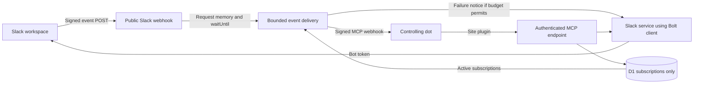

# SlackDot specification

Status: the subscriptions-only, request-scoped runtime is implemented. The forward removal migration and public/private/DM hosted acceptance passed under implementation Step 1; see the implementation plan for current catalog progress and evidence. Historical integration evidence does not by itself verify this revision. External schedulers/services are disallowed.
Last updated: 2026-11-02  
Companion document: [Compatibility prototype plan](compatibility-prototype-plan.md)
Next phase: [Full application implementation plan](implementation-plan.md)

## 1. Purpose

SlackDot is a TypeScript Slack app that exposes an MCP server so an OpenAI dot can communicate in a Slack workspace through a Slack Bot User OAuth token. The dot can read and send messages in the bot's direct messages and in channels the bot has joined. MCP Events notify the dot of matching Slack activity without requiring the dot to poll for messages.

ChatGPT Sites is the intended application deployment platform. The Site will be public so Slack can reach its webhook endpoint without encountering a ChatGPT sign-in gate. Sensitive application operations remain authenticated and authorized.

This document records the full target behavior. It distinguishes that target from capabilities that still require a hosted compatibility test. The prototype established Sites/Slack/native-event compatibility. See [prototype results](compatibility-prototype-results.md) for historical evidence; its retained event/outbox/write records are not part of the target design.

## 2. Accepted decisions

1. Use TypeScript and Slack's Bolt SDK.
2. Use one Slack workspace installation and one bot token per deployment.
3. Exactly one dot controls that bot at any given time. This is an operating constraint, not a distributed ownership system.
4. Do not implement multi-dot ownership, leases, agent routing, per-agent message attribution, or communication between dots through a shared bot.
5. Multiple filtered event subscriptions from the controlling dot are allowed. They do not imply multiple bot owners.
6. Expand the originally requested OAuth scopes when needed for the agreed features.
7. Deploy the entire application through ChatGPT Sites, using a public Site and server-side authorization for protected routes. External schedulers and separately hosted delivery infrastructure are explicitly disallowed.
8. Prefer MCP 2.0 HTTP, protocol revision `2026-07-28`, and the webhook event profile documented by OpenAI.
9. Store only subscriptions needed for current operation in D1. Keep event payloads, delivery attempts, notice outcomes and tool-write results in request memory only; no operational history or deduplication database.
10. Start without protocol replay: return `cursor: null` and explicitly document that limitation.
11. Validate the platform with a narrow prototype before implementing the full tool catalog.
12. Use automatic delivery with bounded retries in the originating request's `waitUntil()` window. Stop on success, exhaustion or permanent failure; attempt one threaded failure notice per invocation when appropriate. Do not persist the outcome. Interruption can prevent both delivery and feedback, and cross-request duplicate suppression is not guaranteed.
13. Apply YAGNI: configuration and secrets are Sites environment settings; a minimal owner-only setup view is enough. Do not add a configuration GUI, diagnostics dashboard, audit history, maintenance framework, recovery service or speculative configuration options.
14. The user explicitly accepts possible cross-request duplicate deliveries, notices and writes, and possible loss of both delivery and feedback on interruption, in exchange for subscriptions-only storage, simplicity and convenient Sites deployment. Do not reintroduce operational persistence to eliminate these accepted tradeoffs.
15. Retain `assistant:write` by explicit user choice for possible future investigation. Agent UI features remain outside this implementation task.

## 3. Scope

### Required target functionality

- Discover the bot's accessible public channels, private channels, and existing one-to-one DMs.
- Find workspace users by available profile information and Slack user ID.
- Open a bot-to-user DM.
- Read conversation messages and retrieve thread context where the installed bot token supports it.
- Send channel messages, DM messages, and threaded replies as the bot.
- Update and delete messages authored by the bot.
- Read, add, and remove emoji reactions using the bot identity.
- Subscribe to new messages, with conversation, thread, sender, and mention filters.
- Handle edits, deletions, and reactions as distinct event types.
- Persist subscription state across request termination, restarts, and deployments.
- Retry transient outbound delivery failures within a bounded Sites request background-execution budget, then attempt threaded failure feedback when appropriate.
- Expose useful connection and error information without exposing credentials or private data publicly.

### Non-goals

- Multiple bots, workspace installations, or controlling dots in one deployment.
- Separate Slack identities for different tasks or conversations.
- Group DMs, organization-wide installation management, or Enterprise Grid administration.
- Reading conversations the bot cannot access, or DMs between other users.
- Workspace-wide message search, file upload/download, channel creation, automatic joining, invitations, or membership administration.
- Email-address lookup unless a later feature explicitly requires it.
- A separate language-model runtime or an OpenAI API key: the dot performs reasoning outside SlackDot.
- Configuration GUIs, diagnostics dashboards, operational-history storage, cached Slack content, Slack Agent View UI, slash commands, or interactive Block Kit workflows in the initial version.
- Supporting every revision or delivery mode of the evolving MCP Events proposal.
- A general webhook delivery product or an exactly-once distributed messaging guarantee.

## 4. User workflows

### Conversation initiated by the dot

1. The dot identifies a permitted channel or a Slack user.
2. For a new DM, it opens the conversation and obtains its conversation ID.
3. It calls a messaging tool with the conversation ID, text, and optional parent thread timestamp.
4. SlackDot authorizes the call and uses the server-held bot token to call Slack.
5. The tool returns the actual Slack conversation ID and message timestamp.

### Conversation initiated in Slack

1. The controlling dot has an active subscription for the relevant conversation or message filter.
2. A person posts a matching message in Slack.
3. Slack sends the event to the public `/slack/events` endpoint.
4. SlackDot verifies and normalizes the request in memory, registers bounded work with `ctx.waitUntil()`, and acknowledges Slack within three seconds.
5. Background work reads matching active subscriptions and sends signed callbacks. Event content and execution state are never written to D1.
6. The dot decides whether to retrieve more context or respond, according to the user's instructions.
7. If it responds, it calls a SlackDot tool. SlackDot suppresses its own bot's resulting activity from automatic event delivery to prevent a response loop.
8. If callback receipt cannot be confirmed within the delivery budget, SlackDot stops attempts and attempts one failure notice in the source thread. Callback acceptance is sufficient for success; waiting for the dot to finish its task or reply is not part of the delivery budget.

Installing SlackDot alone does not instruct the dot to answer every Slack message. Event subscriptions and the dot's response instructions are established in ChatGPT.

## 5. Slack configuration and permissions

### Bot scopes

The initial requested scope set is the user's original list plus `channels:read` and `groups:read`:

| Scope | Purpose |
| --- | --- |
| `app_mentions:read` | Receive explicit mentions of the bot. |
| `assistant:write` | Explicitly retained for possible future Agent UI investigation; no Agent UI features are in scope for this implementation. |
| `channels:read` | Discover public channels and inspect their metadata/membership. |
| `channels:history` | Read messages and receive message events in joined public channels. |
| `chat:write` | Post messages and modify the bot's own messages. |
| `groups:read` | Discover private channels accessible to the bot and inspect their metadata. |
| `groups:history` | Read messages and receive message events in joined private channels. |
| `im:history` | Read and receive events in bot DMs. |
| `im:read` | Discover and inspect bot DMs. |
| `im:write` | Open bot-to-user DMs. |
| `reactions:read` | Read reactions and receive reaction events. |
| `reactions:write` | Add and remove the bot's reactions. |
| `users:read` | List users and retrieve available profile information. |

Do not add `chat:write.public`, `chat:write.customize`, channel-join scopes, `mpim:*`, file scopes, or `users:read.email` without a corresponding approved feature. Posting remains tied to the bot's actual identity and conversation access. Scope changes require reinstallation or reauthorization in Slack as appropriate.

### App configuration

- Enable the bot and the Messages tab, including user message input.
- Enable the HTTP Events API and use the deployed public `/slack/events` URL.
- Complete Slack's URL-verification challenge.
- Use `message.channels`, `message.groups`, and `message.im` as the canonical source of new messages, including explicit mentions. Ignore separate `app_mention` notifications for new-message fanout if still configured, avoiding a second source that would require cross-request merge state.
- Subscribe to `reaction_added` and `reaction_removed` for the full implementation.
- Handle installation revocation/uninstallation signals where available, and disable affected operations when Slack reports invalid or revoked credentials.
- Use HTTPS event delivery. Socket Mode is outside the Sites implementation target.
- Install the app and explicitly add the bot to channels it should use.

The published Slack app manifest must be checked against the actual granted token scopes. Application startup/setup should use `auth.test` to establish the configured workspace and bot identity. Do not infer those values from user-controlled tool arguments.

## 6. Deployment architecture

### Sites application

- Preserve the supported Sites build integration and deployment manifest.
- Use the supported server starter with a Cloudflare Workers request entry point.
- Declare the `mcp` capability and a D1 binding in `.openai/hosting.json`.
- No R2 binding is needed for the initial scope.
- Expose stateless MCP HTTP requests at `/mcp`; subscription state lives in D1, not in an MCP session or Worker isolate.
- Use the Site-created plugin and Sites' MCP identity mechanism when supported by the hosted compatibility tests.
- Store runtime credentials through Sites secrets/environment settings. Never put secrets into source, deployment manifests, browser code, or tool results.

### Bolt integration

Use a small Fetch-compatible custom Bolt receiver to bridge the Workers request lifecycle into Bolt. Preserve raw request bytes for Slack signature verification. Keep the receiver responsible for request verification, challenge handling, in-memory normalization, and acknowledgment timing. Keep application listeners short and attach delivery explicitly to the request execution context before returning the acknowledgment.

The prototype must prove the selected Bolt and Slack Web API client versions actually bundle and run in Sites. Node compatibility support does not by itself prove the complete dependency graph works. Avoid relying on an always-running `app.start()` process, in-memory job queue, or resident Socket Mode connection.

### Bounded Sites-only execution

Use `ctx.waitUntil()` to run delivery from the validated in-memory event while acknowledging Slack promptly. Invoke the delivery function directly; there is no self-HTTP call, outbox, manual runner, scheduled worker, or separately hosted service.

Allow up to 20 seconds for subscription reads, authorization, callback calls and retry delays, then up to five seconds for best-effort threaded feedback, with safety margin before the platform's shared 30-second post-response window. Use the existing short backoff and actual network cancellation. All matching subscriptions share the same invocation budget with bounded concurrency. Start at most three callback attempts per matching subscription per invocation, and fewer when Retry-After or remaining time requires it. Keep constants in code; add environment knobs only for an established need.

The window is an execution limit, not a promise that delivery or a notice succeeds. Runtime termination, network failure, unavailable subscriptions or failed Slack writes can prevent both. The Slack HTTP acknowledgment has already been sent; a later delivery error cannot replace it. Failure feedback is a separate best-effort Slack API call. No event state survives the invocation and no recovery or inspection service is provided.

A separate Slack redelivery is a separate invocation and may repeat delivery or feedback. Without shared receipts there is no reliable way to distinguish a lost acknowledgment from an event that never ran. Process verified redeliveries under the same bounded policy rather than dropping them solely because of the retry header. Retain stable logical event IDs so the recipient can recognize duplicates; do not claim recipient deduplication or exactly-once side effects.

### Suggested module boundaries

| Module | Responsibility |
| --- | --- |
| `slack/receiver` | Verify and acknowledge Slack HTTP requests; bridge into Bolt. |
| `slack/service` | Typed Slack operations and token-bound workspace checks. |
| `slack/normalize` | Normalize message, mention, edit, delete, and reaction payloads. |
| `mcp/server` | Core discovery, tool discovery, tool calls, and request authorization. |
| `mcp/events` | OpenAI-compatible event methods, schemas, and protocol errors. |
| `events/subscriptions` | Subscription identity, validation, expiration, and refresh. |
| `events/delivery` | Matching, signed callback verification, delivery, and retries. |
| `storage` | Subscription storage and deletion only. |
| `runtime` | Sites bindings, secrets, request context, and bounded background execution. |

These are code boundaries, not requirements for separate services or a generalized plugin framework.

## 7. Public hosting and authorization

Public Site access removes the platform sign-in gate for Slack's webhook. It does not authorize anonymous callers to send messages or access Slack data.

| Surface | Access policy |
| --- | --- |
| `/` and `/health` | Public, non-sensitive service information only. |
| `/slack/events` | Publicly reachable; requires valid Slack signatures and freshness checks. |
| `/mcp` tool calls and event subscription operations | Require a trusted Sites-authenticated principal matching the configured owner. |
| MCP discovery/catalog metadata | Protected by default; may be exposed without Slack data only if the native plugin scanner requires it and that behavior is explicitly verified. |
| `/setup` | Owner-only view of configuration presence, verified connection identity and minimal current subscription state; never secret values or event history. |

Requirements:

- Configure the owner from trusted setup or authenticated owner context. Never grant ownership to the first unauthenticated request.
- Validate the trusted Sites identity headers and demonstrate that external clients cannot forge them through the public ingress.
- A signed-in visitor who is not the configured owner cannot invoke protected operations merely because the Site is public.
- Use one owner authorization boundary. Do not create per-agent ownership, roles, or routing.
- Preserve authentication on `events/subscribe` and `events/unsubscribe`; callback verification alone does not authorize a subscription.
- Authorize conversation access when creating subscriptions and throughout their lifetime. Stop delivery when the bot loses access or the installation is revoked.
- Keep the Slack bot token entirely server-side. An MCP client never supplies or receives it.

Changing the controlling dot is an operational handoff: stop the old dot's monitoring and remove obsolete subscriptions before connecting the replacement. No automated ownership-transfer protocol is required.

## 8. MCP tool contract

Tool names below are the proposed stable public names. Inputs use Slack IDs, not ambiguous display names. All tools operate within the single configured workspace.

| Tool | Essential arguments | Behavior |
| --- | --- | --- |
| `slack_get_connection_info` | None | Return non-secret workspace/bot identity and enabled capabilities. |
| `slack_list_conversations` | Optional conversation types, `cursor`, `limit` | Return accessible joined channels and bot DMs. Filter public channel discovery by bot membership. |
| `slack_get_conversation` | `conversation_id` | Return permitted conversation metadata and availability. |
| `slack_list_users` | Optional `cursor`, `limit`, name filter | Return available user profiles; no email lookup. Apply name filtering to the requested page and expose continuation; no profile cache or invented Slack search method. |
| `slack_get_user` | `user_id` | Return available profile information for the specified Slack user. |
| `slack_open_dm` | `user_id` | Open or retrieve the bot's one-to-one DM and return its conversation ID. |
| `slack_get_messages` | `conversation_id`, optional time bounds, `cursor`, `limit` | Read paginated conversation history. |
| `slack_get_thread` | `conversation_id`, `thread_ts`, optional `cursor`, `limit` | Retrieve thread context; report source/completeness and any unsupported token behavior. |
| `slack_send_message` | `conversation_id`, `text`, optional `thread_ts` | Post a new message or thread reply and return Slack identifiers. |
| `slack_update_message` | `conversation_id`, `message_ts`, `text` | Update a bot-authored message. |
| `slack_delete_message` | `conversation_id`, `message_ts` | Delete a bot-authored message. |
| `slack_get_reactions` | `conversation_id`, `message_ts` | Return reaction information available from Slack. |
| `slack_add_reaction` | `conversation_id`, `message_ts`, `emoji_name` | Add the bot's reaction. |
| `slack_remove_reaction` | Same as add | Remove the bot's reaction. |

### Common behavior

- Validate input and output schemas. Use the MCP SDK for core protocol behavior and isolate the event-extension adapter.
- Return structured data with a concise text representation suitable for the agent.
- Keep `ts` and `thread_ts` as strings. Never parse Slack message identifiers into floating-point values.
- Bound pagination and response sizes. Return continuation cursors rather than fetching an entire workspace implicitly.
- Return Slack IDs and normalized error categories; do not leak credentials, raw headers, or callback URLs/secrets.
- Distinguish not-found, not-in-conversation, missing-scope, rate-limited, unavailable, and ambiguous-write outcomes.
- Respect Slack rate limits and `Retry-After`; do not hold MCP requests open indefinitely while sleeping through long limits.
- Mark read tools and write/destructive tools accurately in MCP metadata. Tool annotations are not a substitute for authorization.
- Initially support plain text and Slack `mrkdwn`; raw arbitrary Block Kit and file payloads are outside scope.
- Keep replies in their specified thread. Do not broadcast replies to a channel by default.

### Write behavior without stored request records

Call Slack once for a requested mutation; do not automatically retry an ambiguous write. Return Slack's confirmed identifiers or a normalized error/uncertain outcome directly to the caller. An unavailable response is not proof the action failed. The dot may inspect Slack with ordinary read tools before deciding what to do next; no reconciliation endpoint or history store is required.

Remove the durable request ledger and stored-success replay contract. The deployed send tool's `request_id` may remain as an optional, transient compatibility input for existing saved instructions; do not store it or promise deduplication from it. New tools need no application request ID. Advertise idempotency only where the operation's actual Slack semantics support it, not for message creation. Separate repeated tool calls can create duplicate posts. Use verified Slack data and bot-token authorization to enforce ownership on edit/delete, never local write history.

## 9. MCP Events contract

### Compatibility profile

Implement the OpenAI-documented webhook profile for dots, using the same authenticated `/mcp` endpoint as tools:

- Advertise `events` alongside `tools` in the supported discovery response.
- Implement `events/list`, `events/subscribe`, and `events/unsubscribe` as protocol methods, not ordinary MCP tools.
- Advertise only `webhook` delivery.
- Use `inputSchema` for subscription arguments and `payloadSchema` for delivered event data.
- Use the MCP SDK's selected protocol envelopes and validate actual wire responses against the client. Do not mix incompatible examples from different protocol revisions.
- Do not implement polling, event streaming, `gap`, or `terminated` notifications for the initial OpenAI integration.
- Follow OpenAI's documented behavior where the evolving SEP differs. Pin dependency versions and preserve tested protocol fixtures.

OpenAI's documentation currently identifies callback verification failure as `-32015` (`CallbackEndpointError`); newer draft material has changed error numbering. Treat this as a compatibility fixture rather than silently tracking the latest draft.

### Event catalog

| Event | Meaning |
| --- | --- |
| `slack.message.created` | A newly posted user message or eligible message from another bot. |
| `slack.message.updated` | An existing message was edited. |
| `slack.message.deleted` | An existing message was deleted. |
| `slack.reaction.added` | A reaction was added to a message. |
| `slack.reaction.removed` | A reaction was removed from a message. |

Do not expose a separate mention event initially. Represent an explicit bot mention as a property of the normalized message and support it as a subscription filter.

### Subscription filters

Require `conversation_id` for each initial event subscription. This permits monitoring any supported conversation while keeping the first implementation's subscriptions narrow and explicit.

- `thread_ts`: optional; match the selected root/thread, with documented inclusion of the root message.
- `sender_user_ids`: optional for message events; match message authors. For deletions whose author cannot be resolved, do not infer a match.
- `mentions_only`: optional for created/updated message events; match explicit mentions of the configured bot.
- `include_bot_messages`: default `false`; when enabled, includes other bots only. The app's own bot remains excluded.
- `actor_user_ids` and `emoji_name`: optional for reaction events.

Each event exposes only filters that it can implement correctly. Reject unknown fields and invalid combinations. For unavailable edit/delete metadata, retain unknown values explicitly rather than fabricating an author, thread, or message text. If bot identity cannot be determined, suppress that edit/deletion even with bot opt-in so the app cannot deliver its own activity. Thread-filtered edits/reactions can resolve their source through one bounded live exact-message lookup; no cross-request cache is used.

### Event payloads

All delivered events use the envelope fields `eventId`, `name`, `timestamp`, `data`, and `cursor`. `timestamp` is the occurrence time in ISO 8601 form. `cursor` is `null` initially.

Common application data includes:

- `workspace_id`, `conversation_id`, and `message_ts`.
- `thread_ts` when known.
- Author or actor IDs when available.
- Text or a bounded preview when applicable, with an explicit truncation indicator.
- Bot/mention flags when applicable.
- Event-specific edit, deletion, or reaction details.

Use a unique stable event ID across retries. Message text remains untrusted data; it must not be converted into instructions about how the dot should behave. Minimize event payloads and use the read tools for additional context.

### Subscription lifecycle

1. Authorize the owner, event, and conversation; validate arguments.
2. Validate the HTTPS callback and client-supplied `whsec_` secret, including decoded key length required by the OpenAI profile.
3. Send and verify a signed, short-lived callback challenge before releasing Slack data.
4. Persist the subscription with a deterministic identity derived from principal, callback URL, event name, and canonical JSON arguments.
5. Return the granted expiration as `refreshBefore`, with `cursor: null` and `truncated: false` for the non-replay profile.
6. Treat a repeated matching subscribe request as a refresh/upsert, including a 60-second active-key rotation overlap with dual signatures, capped by subscription expiry. Same-key refresh does not extend the overlap.
7. Stop deliveries at expiration, on unsubscribe, on revoked access, or when the installation is disabled.
8. Make unsubscribe idempotent and match the authenticated subscription identity; knowledge of a subscription ID grants no authority.

Use a finite subscription lifetime with a 72-hour default. The current implementation also caps grants at 72 hours and honors shorter requested lifetimes; do not add a lifetime configuration parameter without an actual need. Honor requested lifetime limits according to the documented profile. The initial server may decline a no-expiration request by granting a finite lifetime. Expiration is enforced on every use. Delete unsubscribed/revoked records immediately and delete expired rows, including callback secrets, opportunistically during ordinary subscription operations and event handling. No history/tombstones or scheduled cleanup service is needed. Without traffic, physical deletion cannot be guaranteed at the exact expiry instant; expired rows are never eligible for delivery.

### Callback security and signatures

- Require HTTPS and block redirect following during both verification and delivery.
- Prevent requests to local/private/non-public destinations. Validate the chosen approach in the Workers runtime rather than assuming Node-specific DNS pinning is available.
- If the implementation restricts callbacks to trusted OpenAI origins, establish the allowlist from verified integration information; do not guess domains or use loose suffix matching. Arbitrary callback destinations are not a product requirement.
- Use Standard Webhooks signatures and send `webhook-id`, `webhook-timestamp`, `webhook-signature`, and `X-MCP-Subscription-Id`.
- Follow the OpenAI profile's requirement that the delivery `webhook-id` match the envelope `eventId`.
- Serialize each body once and sign/send the same bytes. Generate a fresh signing timestamp and signature for each retry.
- Send one event per request, no larger than 256 KiB. Prefer substantially smaller payloads.
- A `2xx` acknowledges receipt, not completion of the dot's work.
- Retry transient failures with bounded backoff within the shared execution budget. Honor Retry-After; if the requested wait does not fit, stop attempts rather than retry early. Do not retry a delivery rejected with `410` or `413`; do not interpret an individual `410` as authority to remove unrelated subscriptions.

## 10. Request-scoped event processing

### Ingress and matching

- Verify raw-body signature, freshness and configured workspace/app context before processing. Handle URL challenges without delivery.
- Normalize in memory, register background work, and return the Slack acknowledgment within three seconds. Do not wait for callback completion. Reject invalid/unprocessable requests promptly.
- Read and match active subscriptions by event name and declared filters. Do not write ingress receipts, normalized events, matching results or delivery jobs.
- Use canonical message events for new-message delivery; compute mentions from the explicit bot-ID mention in message text. Do not build cross-notification enrichment or message caches.
- Keep logical event IDs stable for the same occurrence; distinguish repeated edits and reaction changes. IDs do not constitute stored duplicate suppression.
- Exclude the app's own messages/actions and failure notices. Do not misclassify edits, deletions or thread summaries as new messages.
- Missing author/thread metadata remains unknown. Unknown values do not satisfy corresponding filters. Use a bounded live read when necessary and possible, not cached history or inferred metadata.

### Delivery and feedback

- Keep serialized payloads, attempt counts, deadlines and results in invocation-local memory only. Reuse identical payload bytes/event IDs across that invocation's retries, with fresh signing timestamps/signatures.
- Recheck subscription existence, expiry and conversation access before sending. Stop when unsubscribe, expiration or revocation is observed. Delete a revoked subscription rather than keeping an inactive history row.
- Callback `2xx` means success and ends attempts; it does not mean the dot has finished its work. On failure, honor bounded attempts, backoff, Retry-After and the shared deadline. No persisted claims, leases, retry queue or terminal state.
- For this invocation, if at least one matching callback succeeds, suppress generic failure feedback. If all eligible attempts fail, attempt at most one notice in the known source thread. Unmatched events and intentional cancellations produce no notice. Never guess a thread for a deleted or unknown source.
- Use the next five seconds for the notice, including authorization. Do not retry an ambiguous notice write, create a notice record, or claim notification without a successful response. Separate duplicate ingress can still produce duplicate notices.
- Drop all event/write execution state when the request/background task completes or terminates. Do not add a cross-request memory cache, substitute durable object, external store, or log-based ledger.

For uncertain/exhausted delivery, use:

> SlackDot couldn't confirm delivery to ChatGPT after several attempts. No further automatic attempts will be made by this delivery run.

Omit “after several attempts” when only one attempt occurred. The wording must allow for a separate Slack redelivery and must not describe a timeout as proof of nonreceipt. A crash can prevent both delivery and this notice.

### History and replay

No protocol replay (`cursor: null`). Read history and threads directly from Slack, with pagination and honest partial/unsupported results. Do not add a cached fallback or preserve copies for diagnostics. The bridge has no recovery state after interruption.

## 11. Subscriptions-only persistence and secrets

D1 stores only current subscription data needed to deliver: deterministic identity, owner, event/filter arguments, callback destination, encrypted signing material, granted expiration and necessary verification metadata. Keep only necessary indexes/uniqueness constraints. Configuration and secrets live in Sites environment settings, not a configuration table or GUI. Platform migration bookkeeping is separate from application data.

Do not store message/event bodies, ingress receipts, event IDs for deduplication, delivery outcomes, attempt logs, notice records, tool-write request hashes/results, user profiles, cached history or audit records. No retention period is authorized for those data. Do not relocate them to R2, KV, external storage, logs, test artifacts or global caches. Temporary request memory is allowed for processing and ends with the invocation.

Delete subscription records when unsubscribed/revoked and remove expired rows on normal activity; no stale-record history, grace period for expired subscriptions, or cleanup state table. Only signing-key material actually needed during an active subscription's bounded rotation overlap may remain within that subscription. Document invocation-driven physical deletion honestly; expiry takes effect without waiting for deletion.

Runtime settings include the Slack token/signing secret, fixed workspace/bot/owner identity, subscription-encryption key and verified callback origins. Commit names only. Remove `/internal/deliver`, its operator script and `DELIVERY_TRIGGER_SECRET`; there are no stored deliveries to drain. Do not introduce a maintenance credential or endpoint to replace them.

The first implementation change must stop operational writes and apply a forward migration dropping `receipts`, `events`, `deliveries`, `delivery_notices`, and `writes`, preserving current subscriptions. Do not export or archive their contents before removal. This removes application tables/data; any platform-managed logs/backups have separate lifecycle controls and must not be represented as erased without evidence.

## 12. Operational simplicity

- Environment variables/secrets configure the deployment. `/setup` is a small owner-only read view: missing configuration names, connection identity/capabilities, and minimal current subscription state when useful. No configuration forms, historical metrics, pagination dashboard or diagnostic record collection.
- Public health reveals only non-sensitive availability. Tool errors go to the authorized caller. Keep application logging minimal and content-free: no per-event audit trail, message/conversation/user IDs, payloads, callback URLs, request bodies or secrets. Do not add log-based retention to replace deleted tables.
- Respect rate limits and return bounded errors. Keep tested SDK/transport/authentication/security boundaries; YAGNI does not remove signature verification, access checks, callback validation, timeouts or safe secret handling.
- Preserve the Sites build/deploy workflow and current subscriptions. The storage-removal migration intentionally removes rejected operational data; do not preserve it under a generic migration-safety rule.
- Keep a concise deployment guide with scopes/events, environment names, URL verification, plugin connection and explicit Dot response instructions. No external scheduler, configuration service, new plugin or rich dashboard.

## 13. Compatibility uncertainties

| Question | Current evidence | Required resolution |
| --- | --- | --- |
| Does Bolt run in the Sites Worker runtime? | Hosted auth.test, native reads/writes, and signed Slack ingress pass. Version 7 durably accepted a human marker in 184 ms and delivered it to the intended dot after a manual trigger. | Retain the verified receiver and transport; full load/performance testing is outside this prototype. |
| Does the Site-created plugin support MCP Events? | Native discovery, subscribe, signed callback verification, and public/private/DM event receipt pass on version 7. Private/DM events triggered verified threaded bot replies. Subscriptions and pending jobs survived redeployment. Pausing a temporary automation sent events/unsubscribe and received a successful handler result. | Automatic public/private/DM round trips also pass on clean version 9 without a manual delivery trigger. Rely on documented automatic ChatGPT renewal; a separate live renewal experiment is not required by the user. No SlackDot-specific observation of automatic renewal is claimed. |
| Does bounded delivery and failure feedback work entirely on Sites? | Clean version 9 implements automatic post-commit delivery, shared deadlines, short retries, terminal state, and deduplicated notices. The 54-test suite and built-Worker failure matrix pass. A controlled hosted fixture exhausted three attempts and produced one real, verified threaded Slack notice; its temporary hook was removed. | Real automatic public/private/DM round trips pass on clean version 9: first-attempt delivery in about 1.3 seconds, one verified bot reply each, no failure notice or self-loop. The controlled fixture is not evidence of an actual OpenAI outage. Retain the interruption limits; verify the subscriptions-only replacement before calling it implemented. The old persistence/deduplication evidence does not prove that replacement; no external scheduler is permitted. |
| Is public hosting compatible with owner-only MCP access? | Native owner calls pass; hosted anonymous and forged-header probes are rejected. | Test a signed-in non-owner; retain the proven owner and ingress checks. |
| Can callback egress checks be satisfied in Workers? | Exact-origin restriction is active for the independently checked OpenAI hostname; native challenge and delivery pass. Redirect/private-destination rejection is covered locally. | Retain exact-origin policy and independently verify any future destination changes; arbitrary destination DNS pinning is not claimed. |
| Can this bot read channel threads? | Live public, private, and DM reads pass with the installed bot token. Three-message fixtures also passed native cursor continuation in all three types, with the parent repeated across pages. | Retain verified support; combine pages by message timestamp and follow opaque cursors. Broader history coverage and page-size/order guarantees are not established by these fixtures. |

These are proof obligations, not permission to quietly narrow the target behavior. Unsupported capabilities must be reported with their practical effect and any proposed alternative.

## 14. Full implementation acceptance criteria

- Sites deployment, public signed ingress, owner-only tools/subscriptions and non-owner rejection work without external infrastructure.
- Only current subscriptions exist as application data in D1. No operational payloads, receipts, delivery/notice/write records or caches are created by success, failure, retries or tool calls; superseded tables/data are removed.
- Expired subscriptions cannot deliver; unsubscribe/revocation deletes the row; opportunistic expiry deletion preserves valid subscriptions. The default lifetime is 72 hours, with documented automatic ChatGPT renewal and no required live renewal experiment.
- Conversation/user discovery, DM opening, history, threads, messaging, bot-only modifications and reactions meet the tool contract with bounded pagination and honest limitations.
- Valid events trigger automatic in-memory delivery after prompt acknowledgment. Matching excludes self activity and redundant app-mention fanout; stable IDs are provided, but cross-request delivery/write/notice deduplication is not promised.
- Short retries, per-invocation attempt/time bounds, Retry-After, cancellation and best-effort feedback work without persisted jobs or a manual trigger. Successful callbacks do not produce failure notices while the dot runs.
- Termination loses invocation state and may prevent both delivery and feedback. No replay, later recovery, inspection of lost state or guaranteed error response is claimed.
- Uncertain Slack writes are not automatically resent or stored. MCP metadata and tool descriptions no longer promise stored-result replay or idempotent message creation.
- Setup is minimal and owner-only, configuration uses environment settings, and public responses/logs/artifacts expose no secrets or Slack content.

## 15. Research sources and compatibility baseline

Research was conducted on 2026-11-02. Recheck these sources during implementation because the event extension and hosting integration are evolving.

- [OpenAI MCP Events](https://developers.openai.com/plugins/build/mcp-events): target client behavior and webhook profile.
- [ChatGPT Sites](https://learn.chatgpt.com/docs/sites?surface=app): supported application hosting and storage.
- Installed Sites plugin v1.1.2 guidance: `references/site-mcp-server.md`, `identity-and-secrets.md`, `storage.md`, and `recurring-updates.md`. These establish the inspected native plugin, identity, D1, and scheduling contracts; they do not establish native queue provisioning or event discovery.
- [Official MCP TypeScript SDK](https://github.com/modelcontextprotocol/typescript-sdk): core SDK and protocol support.
- [MCP Events design sketch](https://github.com/modelcontextprotocol/experimental-ext-triggers-events/blob/main/docs/design-sketch-proposal.md) and [SEP-3415](https://github.com/modelcontextprotocol/modelcontextprotocol/pull/3415): evolving draft context. OpenAI's supported profile takes precedence for this integration.
- [Hookdeck background article](https://hookdeck.com/webhooks/guides/what-are-mcp-events): background and links to the proposal, not the implementation authority.
- [Slack Events API](https://docs.slack.dev/apis/events-api/), [message events](https://docs.slack.dev/reference/events/message/), and [HTTP request URLs](https://docs.slack.dev/apis/events-api/using-http-request-urls/).
- [Bolt custom receivers](https://docs.slack.dev/tools/bolt-js/concepts/receiver/) and [Slack signature verification](https://docs.slack.dev/authentication/verifying-requests-from-slack/).
- [Conversation discovery](https://docs.slack.dev/reference/methods/conversations.list/), [history](https://docs.slack.dev/reference/methods/conversations.history/), and [current thread reference](https://docs.slack.dev/reference/methods/conversations.replies/). The [older thread reference](https://api.slack.com/methods/conversations.replies) documents the conflicting bot-token limitation.
- [Slack message posting](https://docs.slack.dev/reference/methods/chat.postMessage/) and [rate-limit clarification](https://docs.slack.dev/changelog/2025/05/29/rate-limit-changes-for-non-marketplace-apps/).
- [Cloudflare execution context](https://developers.cloudflare.com/workers/runtime-apis/context/): shared `waitUntil()` lifetime and cancellation limits for the accepted bounded execution design.
